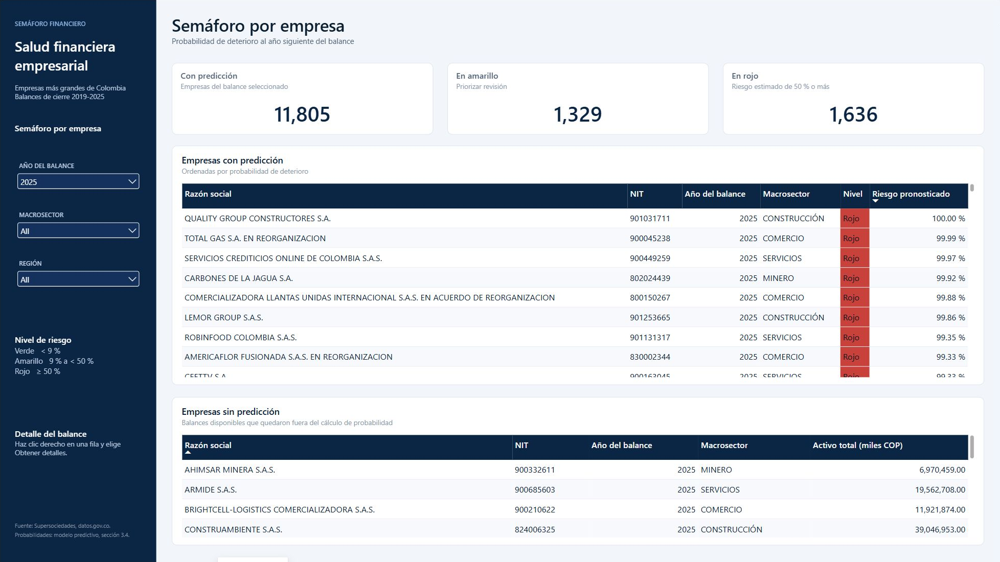
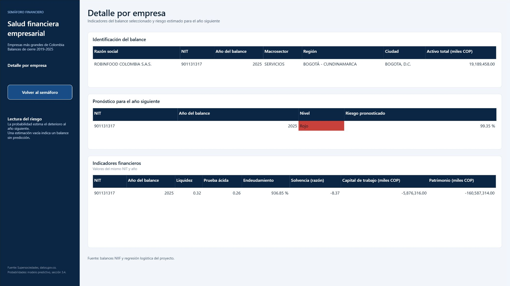

# Semáforo de salud financiera empresarial

Proyecto integrador — Inteligencia de Negocios · Análisis de Datos · Aprendizaje Computacional (ITM).

**Pregunta de negocio:** con el balance de una empresa en el año *t*, ¿podemos anticipar si estará
en deterioro financiero en el año *t+1*? Una empresa está en deterioro si tiene patrimonio negativo
o una liquidez menor que 1.

**Equipo 6:** Julián Zapata, Santiago Villada, Jacobo Osorio y Oscar Alexis Pineda Henao.
Docente: Daniel Alexis Nieto Mora.

## Resultados principales

- Trabajamos con **75.829 balances de 12.761 empresas** entre 2019 y 2025.
- **La pandemia no deterioró a la empresa típica:** entre 2019 y 2020 el 61,7 % de las mismas
  empresas mejoró su liquidez. El peor año fue 2022. Pero la cola de empresas débiles crece: el
  patrimonio negativo pasó del 2,15 % en 2019 al 3,53 % en 2025.
- **El sector importa:** el patrimonio negativo depende del macrosector en los siete años
  (chi-cuadrado).
- **El deterioro es muy persistente:** el 69,6 % de las empresas deterioradas sigue así al año
  siguiente. Por eso la regla "igual que este año" ya logra un F1 de 0,718, y ningún modelo la
  superó con su umbral. La regresión logística sí ordena mucho mejor el riesgo (ROC-AUC de 0,901
  frente a 0,833).
- **El semáforo separa el riesgo:** en los años de prueba se deterioró el 3,6 % de las empresas en
  verde, el 16,2 % en amarillo y el 73,2 % en rojo. El amarillo es la alerta temprana: reunió el
  37,6 % de los casos nuevos con solo el 11,5 % de los balances.
- **Para 2026:** 1.636 empresas en rojo y 1.329 en amarillo, de las cuales 1.272 estaban sanas en
  2025. Agropecuario es el sector con más riesgo: el 57,7 % de sus empresas queda en amarillo o rojo.

Las conclusiones completas, las recomendaciones por actor, las limitaciones y la reflexión ética
están en la sección 5 del notebook.

## Dashboard

`dashboard/semaforo_financiero.pbix` tiene cuatro páginas:

| Página | Para quién | Qué muestra |
|---|---|---|
| Vista directiva | Directivos | KPIs generales, empresas por nivel del semáforo y evolución del riesgo |
| Vista sectorial y regional | Áreas de análisis | Liquidez, endeudamiento y patrimonio negativo por año, etapa del COVID, macrosector y departamento |
| Semáforo por empresa | Supervisión y riesgo | Empresas ordenadas por probabilidad de deterioro, con su nivel. Aparte, los balances sin predicción |
| Detalle por empresa | Supervisión y riesgo | Indicadores y pronóstico de una empresa (se abre con clic derecho > Obtener detalles) |

Al escoger 2025 como año del balance, el tablero muestra el pronóstico para 2026: 11.805 empresas
con predicción. Otros 17 balances de 2025 no tienen pasivo corriente para calcular la liquidez, así
que no tienen predicción y quedan por fuera del semáforo.





## Fuentes de datos (datos.gov.co)

| Base | Publica | Uso |
|---|---|---|
| [Estados Financieros NIIF – Estado de Situación Financiera](https://www.datos.gov.co/d/pfdp-zks5) | Supersociedades | Balances por empresa y año |
| [10.000 Empresas más Grandes del País](https://www.datos.gov.co/d/6cat-2gcs) | Supersociedades | Sector, región, ciudad, ingresos y ganancia |

## Estructura

```
data/raw/          descargas crudas (no se suben al repositorio)
data/processed/    datos limpios, modelo estrella, dataset de modelado y predicciones
notebooks/         proyecto_integrador.ipynb (una sección por etapa)
dashboard/         semaforo_financiero.pbix
docs/              diccionario de datos y capturas del dashboard
```

| Sección del notebook | Contenido |
|---|---|
| 1. ETL | Extracción por API, limpieza, integración y modelo estrella |
| 2. EDA e inferencia | Descriptiva, tendencias, correlaciones, anomalías y pruebas de hipótesis |
| 3. Modelos | Variable objetivo, preprocesamiento y PCA, entrenamiento, evaluación y predicciones |
| 4. Dashboard | Reglas del semáforo y modelo de datos para Power BI |
| 5. Cierre | Conclusiones, recomendaciones, limitaciones y ética |

Las tablas que lee Power BI y sus relaciones están en `docs/diccionario_datos.md`.

## Cómo ejecutar

### Notebook

```bash
python -m venv .venv
# Windows: .venv\Scripts\activate   |   Linux/Mac: source .venv/bin/activate
pip install -r requirements.txt
jupyter notebook notebooks/proyecto_integrador.ipynb
```

Opcional: crear un token gratuito en datos.gov.co y guardarlo en la variable de entorno
`DATOS_GOV_TOKEN` para que la API no limite las descargas.

- La sección 1 descarga los datos a `data/raw/`. Las secciones 2 a 5 trabajan con los archivos de
  `data/processed/`, que sí están en el repositorio, así que se pueden ejecutar sin volver a
  descargar nada.
- Las secciones 3.3 y 3.4 usan lo que deja en memoria la sección anterior: hay que ejecutar 3.2,
  3.3 y 3.4 en ese orden y en la misma sesión. El entrenamiento del SVM en la 3.3 tarda unos
  minutos.
- Si se vuelve a ejecutar la 3.4, hay que ejecutar después la 4.1 para que `predicciones.csv`
  recupere las columnas del semáforo.

### Power BI

Power BI Desktop solo funciona en Windows.

1. Abrir `dashboard/semaforo_financiero.pbix`.
2. En **Inicio > Transformar datos > Editar parámetros**, cambiar `RutaDatos` por la ruta completa
   de la carpeta `data\processed\` del repositorio en el propio computador (terminada en `\`).
3. Dar clic en **Actualizar**.

## Decisiones técnicas

| Decisión | Por qué |
|---|---|
| Mediana e IQR en lugar de media y desviación | La liquidez media es 124,17 y la mediana 1,74: unos pocos balances extremos arrastran los promedios |
| Wilcoxon en lugar de la t pareada | Las diferencias no son normales, y la t no habría detectado el cambio de 2020 (p = 0,232) |
| Variables solo del año *t* y división temporal (entrenamiento 2019-2022, prueba 2023-2024) | Evita la fuga de información y simula el uso real: predecir años que el modelo no ha visto |
| `log1p` antes de `StandardScaler` en las razones financieras | Sin la transformación, el 99,88 % de las liquideces quedaba aplastado cerca de cero |
| Comparar los modelos contra la regla "igual que este año" | El deterioro es tan persistente que una regla sin modelo ya acierta mucho |
| Regresión logística como modelo final | Su probabilidad coincide con lo que pasa, no memoriza el entrenamiento y cada alerta se explica con sus coeficientes |
| Semáforo con tres niveles: amarillo desde 0,09 y rojo desde 0,5 | Con el umbral de 0,5 solo se marcan empresas ya deterioradas; el amarillo es el percentil 90 de las sanas en entrenamiento |

## Limitaciones y ética

- Solo cubre las empresas del ranking de las 10.000 más grandes que reportan a Supersociedades:
  las pymes quedan por fuera.
- Las empresas que dejaron de reportar no están en el entrenamiento (sesgo de supervivencia), así
  que el modelo puede subestimar el riesgo de los casos más graves.
- El semáforo es una **alerta temprana para priorizar revisiones, no un diagnóstico**. Muestra
  empresas con nombre y NIT, así que debe tener acceso restringido y revisión humana antes de
  cualquier decisión. La sección 5.5 del notebook revisa la normativa (Leyes 1712 de 2014, 1581 de
  2012, 1266 de 2008 y 1116 de 2006) y los sesgos del modelo.

## Plan de trabajo

| Etapa | Julián | Santiago | Jacobo | Oscar |
|---|---|---|---|---|
| 1. ETL | C1 Extracción por API | C2 Limpieza y pivoteo | C3 Integración y validación | C4 Indicadores y modelo estrella |
| 2. EDA | C5 Descriptiva | C6 Tendencias | C7 Correlaciones y anomalías | C8 Pruebas de hipótesis |
| 3. ML | C9 Variable objetivo | C10 Escalado, codificación y PCA | C11 Entrenamiento | C12 Evaluación |
| 4. BI y cierre | C13 Modelo de datos BI | C14 Vistas directiva y sectorial | C15 Semáforo por empresa | C16 Conclusiones y ética |
